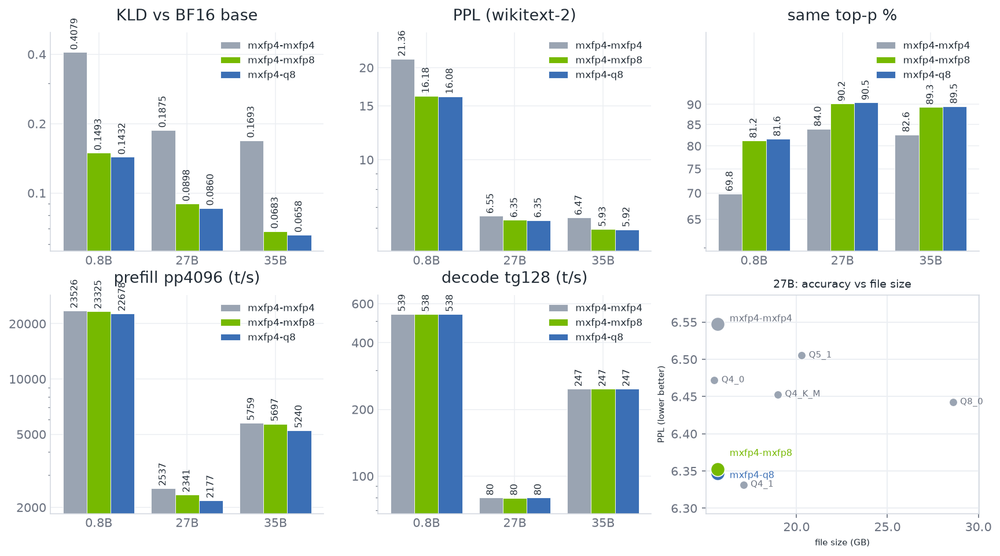

## Overview

Adds a W4A8 path for MXFP4 `mul_mat` on Blackwell. `src1` is quantized to e4m3 values with one ue8m0
scale per 32 values and multiplied against the e2m1 weights with the block-scaled MMA instruction
`kind::mxf8f6f4` (`m16n8k32`, `scale_vec::1X`). On Blackwell, MXFP4 layers use this path by default.
`GGML_CUDA_MMQ_PREC` keeps `q4` (e2m1 activations, the existing `kind::mxf4` instruction) and `q8`
(q8_1 activations), and adds `fp8` (this path).

Decode is not affected: a dense MXFP4 `mul_mat` with `ne11 <= 8` (7 for `mul_mat_id`) goes to MMVQ,
which quantizes `src1` to q8_1, and the fused gate/up GLU path keeps `GGML_PREC_Q8`. The change
therefore lands on prefill and batched `mul_mat` / `mul_mat_id`; the `tg128` columns below are equal
across the three arms.

This is the CUDA mixed-precision MMA piece of [timlikesai/llama.cpp#14](https://github.com/timlikesai/llama.cpp/pull/14),
which also carries the dense MXFP4 ftype, imatrix weight quantization and an MXFP4 KV cache. It is
split out so the change that raises MXFP4 accuracy can be reviewed on its own: it changes how `src1` is
quantized and which MMA instruction runs. The weight format is unchanged. It applies to `master` without
the rest of #14. Dense MXFP4 quantization is planned for a subsequent PR: master already runs dense
MXFP4 files (it logs `llama_model_loader: unknown type mxfp4` only while guessing the file type, because
`LLAMA_FTYPE_MOSTLY_MXFP4_MOE` is the sole MXFP4 ftype today), which is why two of the three models
below are dense.

- `ggml_prec` gains `GGML_PREC_FP8 = 35`. e4m3 is a distinct `src1` rank from `GGML_PREC_Q8`: e4m3
  codes with one ue8m0 power-of-two scale per 32 values, matching the MXFP4 weight scale groups,
  instead of q8_1 fp32 block scales. `ggml_prec` values are stored in `op_params` and read by the
  backend, so no backend needs new logic to carry it: the two exhaustive `ggml_prec` switches in
  `ggml-vulkan.cpp` list the enumerator, SYCL's rank comparisons read it like the other coarse ranks,
  and CPU, Metal, OpenCL, WebGPU and Hexagon do not look at the `src1` rank. `GGML_CUDA_MMQ_PREC`
  stays a debug override; the enum is how a graph asks for e4m3.
- `mma_block_scaled` (was `mma_block_scaled_fp4`, which no longer describes both operands) takes a
  `prec_src1` template argument and emits
  `mma.sync.aligned.kind::mxf8f6f4.block_scale.scale_vec::1X.m16n8k32.row.col.f32.e2m1.e4m3.f32.ue8m0`
  for `GGML_PREC_FP8`. The `kind::mxf4` (`m16n8k64`, e2m1 x e2m1, ue8m0) and `kind::mxf4nvf4`
  (`m16n8k64`, e2m1 x e2m1, ue4m3) instructions already in that function keep their behavior.
- `ggml_cuda_mmq_get_prec_src1` returns `GGML_PREC_FP8` for MXFP4 on Blackwell unless Q4 or Q8 is
  requested. NVFP4 keeps its existing behavior, and off Blackwell FP4 layers keep q8_1 activations.
- `quantize_mmq_fp8` and its MoE scatter variant: one warp per 128-value block, lane `l` holds values
  `4l..4l+3`, `amax` reduced over the 8 lanes of a scale group, block scale
  `2^(rint(log2(amax)) - 8)` from `compute_e8m0_scale(amax, E4M3_EMAX)`, four e4m3 codes packed per lane.
- `ggml_cuda_mmq_load_tiles_mxfp4_fp8` writes the packed e2m1 weights and the ue8m0 scales into the
  SRAM tile; `ggml_cuda_mmq_vec_dot_mxfp4_fp8_mma` unpacks the weights into the `mxf8f6f4` A-fragment
  (one e2m1 per byte, in bits `[5:2]`) and issues the MMA.
- `block_fp8_mmq` with `QK_FP8_MMQ` and `GGML_CUDA_MMQ_SRAM_LAYOUT_FP8`: 128 e4m3 values plus one ue8m0
  scale per 32 values, `static_assert`-sized to `block_q8_1_mmq`. The FP8 config selects
  `K_vram = MMQ_ITER_K`, the same number of blocks per iteration as the q8_1 path.
- MMQ dispatch and template instances for the (MXFP4, `GGML_PREC_FP8`) pair, including `DECL_MMQ_CASE_FP8`
  in the generated instance files. The `src1` stride is taken from `y_block_size / y_values_per_block`.
- `test-backend-ops`: `MUL_MAT_W4A8_FP8` and `MUL_MAT_ID_W4A8_FP8` cases next to the existing
  `MUL_MAT_W4A4` / `MUL_MAT_W4A8` ones - dense and MoE, MoE with and without broadcast `src1`,
  `nrows_x` with and without the MMQ fallback (`nrows_x % 128`), and a `k` that is not a multiple of a
  128-value `src1` block. The three precisions are now requested explicitly per case instead of relying
  on the default, so the W4A4 and W4A8 cases keep testing what they tested before. The nmse tolerance
  follows the effective precision, since `GGML_CUDA_MMQ_PREC` overrides the op parameter.
- `docs/build.md`: the `GGML_CUDA_MMQ_PREC` value list and the Blackwell default.

## Additional information

What the change does not touch: `nvfp4` weight handling and its ue4m3 scales; the MMQ config tables in
`mmq-config-blackwell.cuh`, whose native FP4 shape the FP8 path reuses with `K_vram` and the SRAM layout
overridden; `quantize_mmq_mxfp4` / `quantize_mmq_nvfp4`; and `mul_mat_q_process_tile`, which needs no
code change because its existing `ne_block` expression already gives FP8 the `block_q8_1_mmq` row that
`block_fp8_mmq` is `static_assert`-ed to match (only a stale 2-line comment there is updated, and it is
the only deletion in `mmq.cuh`). `compute_e8m0_scale` gains an `emax` argument and its e2m1 call site
passes the `2` that was inline before, so FP4 activation quantization is bit-identical. In `mmq.cu` the
prec resolution, the MXFP4 dispatch case, the `GGML_CUDA_MMQ_PREC` warning string and the two `s12`
computations are rewritten; `s12` is now derived from `y_block_size / y_values_per_block`, which
evaluates to master's value for both formats that exist today. The diff is 564 lines across 13 files
(+501 / -63).

Correctness, 2x RTX 5070 Ti, `test-backend-ops -b CUDA0 -o "MUL_MAT.*"` - the branch has 9 more cases
than the base, the new FP4 activation ones:

| build | env | result |
|---|---|---|
| branch `804e46dcd` | `unset` | 5045/5045 tests passed |
| branch `804e46dcd` | `q4` | 5045/5045 tests passed |
| branch `804e46dcd` | `q8` | 5045/5045 tests passed |
| branch `804e46dcd` | `fp8` | 5045/5045 tests passed |
| branch `804e46dcd` | `zzz` | 5045/5045 tests passed |
| base `3de52ac38` | `unset` | 5036/5036 tests passed |

All cells below were measured on the 2x RTX 5070 Ti box (driver 615.71.09), on one binary: the branch
build `804e46dcd` on base `3de52ac38`. Only `GGML_CUDA_MMQ_PREC` changes between arms, and every arm
reads the same weight file.

Results

Models, quantized to MXFP4 with imatrix by [timlikesai/llama.cpp#14](https://github.com/timlikesai/llama.cpp/pull/14).
Each repo also carries the imatrix file that was used, so the quants are reproducible:

- [Qwen3.5-0.8B-MXFP4](https://huggingface.co/timlikesai/Qwen3.5-0.8B-MXFP4) (dense)
- [Qwen3.8-27B-MXFP4](https://huggingface.co/timlikesai/Qwen3.8-27B-MXFP4) (dense)
- [Qwen3.6-35B-A3B-MXFP4](https://huggingface.co/timlikesai/Qwen3.6-35B-A3B-MXFP4) (MoE, exercises `mul_mat_id`)

The tables use the `*-mxfp4-imx.gguf` file of each repo. All three arms run on the branch binary:
`mxfp4-mxfp4` is `GGML_CUDA_MMQ_PREC=q4`, which is master's current MXFP4 path (`kind::mxf4`, e2m1
activations); `mxfp4-mxfp8` is the branch default, this path; `mxfp4-q8` is `GGML_CUDA_MMQ_PREC=q8`
(q8_1 activations through the Ampere MMQ config). The `q4` arm is a stand-in for master in the sense
that matters: measured on the base binary `3de52ac38`, the same two files give bit-identical results - 0.8B
KLD 0.407929, PPL 21.359005, same top-p 69.847; 27B KLD 0.187541, PPL 6.547698, same top-p 83.958.

Accuracy, KLD and PPL against BF16 reference logits recorded from the unquantized base:

    llama-perplexity -m <model>-mxfp4-imx.gguf -f wikitext-2-raw/wiki.test.raw \
      --kl-divergence --kl-divergence-base <base>.bin \
      -c 4096 --chunks 72 -ngl 999 -sm tensor -fa on --cache-type-k f16 --cache-type-v f16

Throughput:

    llama-bench -m <model>-mxfp4-imx.gguf -p 4096 -n 128 -ngl 999 -sm tensor -fa on -r 5

Accuracy:

| model | arm | KLD | PPL | same top-p |
|---|---|---:|---:|---:|
| 0.8B  | mxfp4-mxfp4 | 0.4079 | 21.3590 | 69.847 |
| 0.8B  | mxfp4-mxfp8 | 0.1493 | 16.1805 | 81.231 |
| 0.8B  | mxfp4-q8    | 0.1432 | 16.0846 | 81.639 |
| 27B   | mxfp4-mxfp4 | 0.1875 |  6.5477 | 83.958 |
| 27B   | mxfp4-mxfp8 | 0.0898 |  6.3524 | 90.153 |
| 27B   | mxfp4-q8    | 0.0860 |  6.3470 | 90.476 |
| 35B   | mxfp4-mxfp4 | 0.1693 |  6.4713 | 82.628 |
| 35B   | mxfp4-mxfp8 | 0.0683 |  5.9316 | 89.308 |
| 35B   | mxfp4-q8    | 0.0658 |  5.9175 | 89.548 |

`same top-p` is the `llama-perplexity` "Same top p" figure: the share of positions whose argmax equals
the BF16 base model's argmax. It is not nucleus sampling.

Throughput results (t/s, mean ± sd over 5 reps):

| model | arm | pp4096 | tg128 |
|---|---|---:|---:|
| 0.8B  | mxfp4-mxfp4 | 23525.61 ± 118.59 | 539.04 ± 4.35 |
| 0.8B  | mxfp4-mxfp8 | 23324.87 ± 93.02 | 537.69 ± 4.09 |
| 0.8B  | mxfp4-q8    | 22678.14 ± 95.95 | 537.71 ± 4.24 |
| 27B   | mxfp4-mxfp4 | 2537.35 ± 1.82 | 79.81 ± 0.07 |
| 27B   | mxfp4-mxfp8 | 2341.19 ± 1.57 | 79.72 ± 0.06 |
| 27B   | mxfp4-q8    | 2176.77 ± 1.56 | 79.80 ± 0.02 |
| 35B   | mxfp4-mxfp4 | 5759.31 ± 16.61 | 247.34 ± 2.18 |
| 35B   | mxfp4-mxfp8 | 5696.90 ± 8.20 | 247.12 ± 2.19 |
| 35B   | mxfp4-q8    | 5239.99 ± 11.28 | 247.28 ± 2.27 |

The fp8 arm costs 0.9% / 7.7% / 1.1% prefill against the q4 arm on 0.8B / 27B / 35B and gains 2.9% /
7.6% / 8.7% against q8_1, for accuracy close to q8_1 (tables above). Absolute t/s drift 1-2% between
rounds on this box, so read the ratios within one round, not levels across rounds.

The 0.8B cells are noisy at `-r 5`. Re-run at `-r 15` on the same build: `mxfp4-mxfp4` pp4096 23438.40 ± 44.56, tg128 538.50 ± 2.53; `mxfp4-mxfp8` pp4096 23334.33 ± 70.85, tg128 537.25 ± 2.03; `mxfp4-q8` pp4096 22597.16 ± 56.32, tg128 537.90 ± 2.50.

## Requirements

- I have read and agree with the [contributing guidelines](https://github.com/ggml-org/llama.cpp/blob/master/CONTRIBUTING.md)
- AI usage disclosure: YES - [pi.dev](https://pi.dev) with qwen3.8-27b served by llama.cpp wrote the
  code and ran the first measurement rounds; the re-measurement, the chart and the code review pass for
  this revision ran on qwen3.8-flash-next. The author reviewed every change and owns them.
